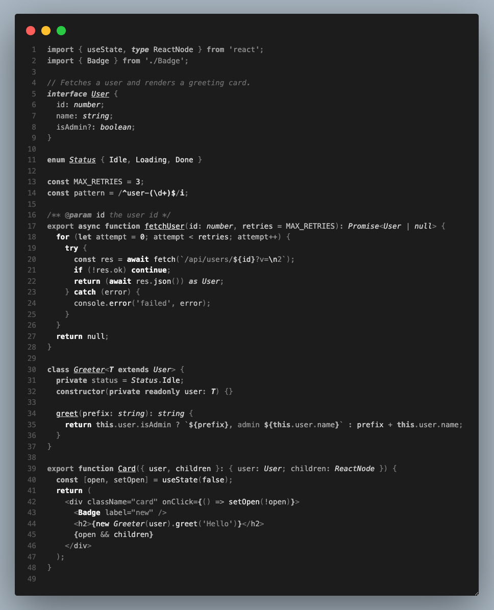
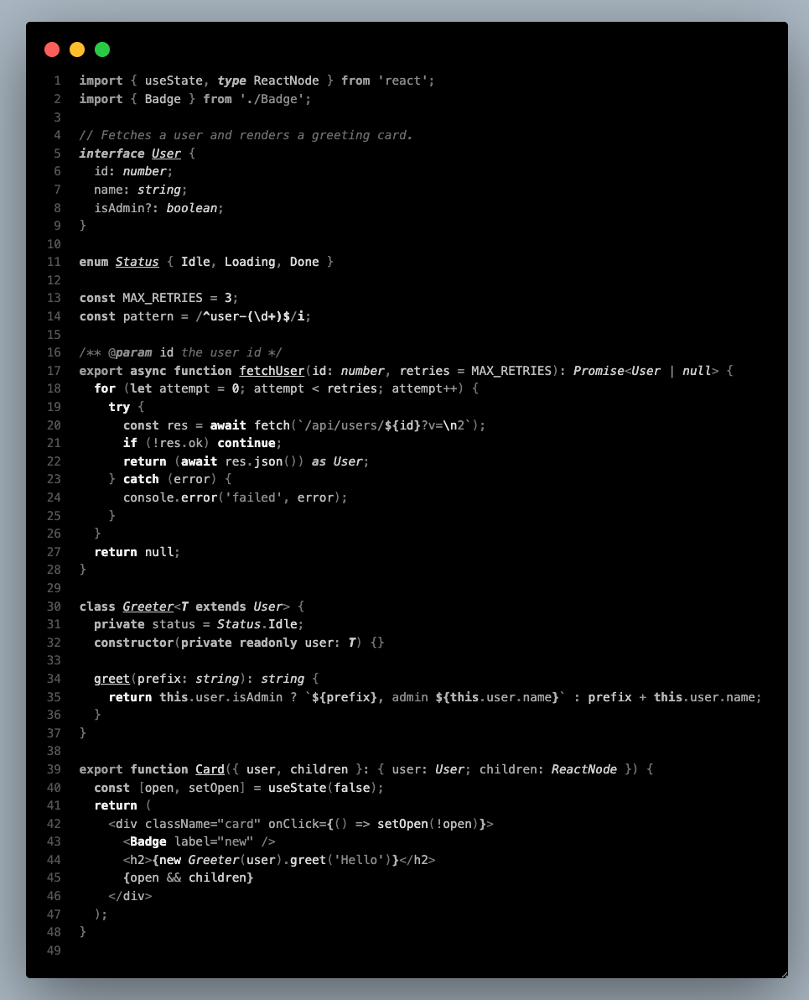
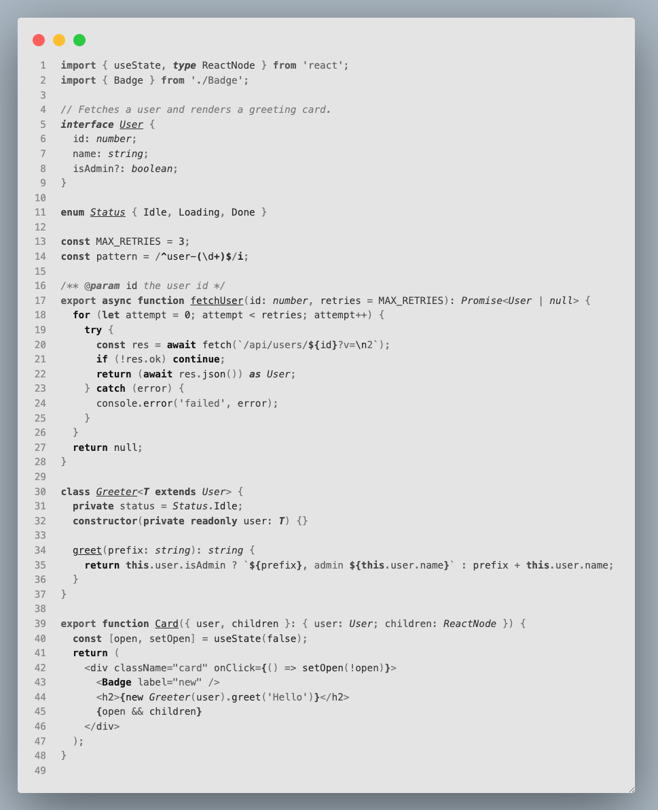

# Gray DP

A noir VS Code theme. Pure gray, no hue in the code — like watching an old black-and-white film.
Roles are separated by **luminance** and **font style** instead of color, with every pairing
checked against WCAG contrast.

## Variants

### Gray DP — `#1c1c1c`, dark gray



### Gray DP Black — `#000000`, pure black for OLED



### Gray DP Light — `#e4e4e4`, light gray, not white



## Reading the styles

Each font style carries one meaning:

| Style | Meaning | Examples |
|---|---|---|
| **bold** | language keyword | `if`, `return`, `await`, `const`, `import` |
| *italic* | the type world | `User`, `string`, `interface`, `keyof`, `as` |
| <u>underline</u> | where a name is defined | `function fetchUser`, `class Greeter` |
| ~~strikethrough~~ | deprecated API | |
| regular | runtime values | variables, calls, strings |

Brightness carries importance: keywords and JSX components are the brightest, then calls and
literals, types, variables, properties, and finally strings, punctuation and comments.

The only color in the theme is a set of muted signals for errors, warnings, git and the terminal.

## Install

Search for **Gray DP** in the Extensions view, or run:

```sh
code --install-extension DevPedroDias.gray-dp
```

Then open *Preferences: Color Theme* (`Cmd+K Cmd+T`) and pick a variant.
Bold, italic and underline are part of the design — use a font that ships a real bold weight
(e.g. JetBrains Mono with all weights installed).

## Development

```sh
npm run build      # regenerate themes/*.json from src/
npm run watch      # rebuild on every change in src/
npm run contrast   # WCAG contrast of every syntax role, per variant
node scripts/inspect.mjs samples/sample.tsx   # role of each token in a file (--scopes for raw scopes)
```

Press F5 to open an Extension Development Host, then pick a Gray DP variant in
*Preferences: Color Theme*. Everything is generated from `src/palette.mjs`.
